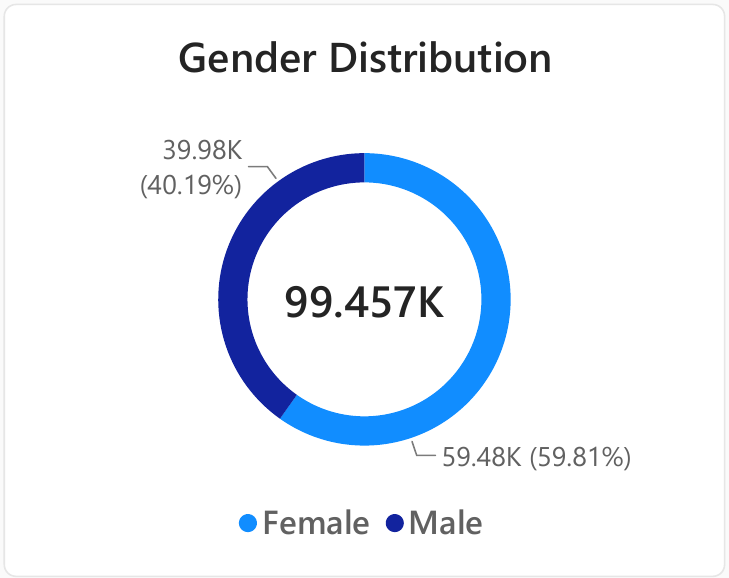

# 🛍️ Customer Data Analysis: Shopping Behaviour by Gender, Age, Category & Payment Method

> Analysis of **99,457 retail transactions (TL 251.5M revenue)** across **10 Istanbul
> malls (Jan 2021 - Mar 2023)**, with a Power BI dashboard, statistical testing
> (chi-square) and business recommendations.

---

## 🎯 Business Problem
A retailer operating in 10 shopping malls wants to know **who its customers are, what they
buy and how they pay**, so it can target marketing, protect revenue and decide where
to invest.

**Questions answered**
- Which gender did we sell more products to, and which generated more revenue?
- Which age group bought the most, and which generated the most revenue?
- Which categories and malls drive the business?
- Does payment method (cash / credit / debit) depend on gender, age or category?

---

## 🛠️ Tools & Skills
| Area | Tools |
|---|---|
| Dashboard and visualisation | Power BI Desktop |
| Data preparation | Excel / SQL (keep what you used) |
| Statistics | Chi-square tests of independence |
| Reporting | PDF report, PowerPoint presentation |

**Skills shown:** customer segmentation, KPI design, dashboard building, hypothesis
testing, data storytelling, business recommendations.

---

## 📊 Key KPIs
| Metric | Value |
|---|---|
| Total revenue | **TL 251.5M** |
| Total units sold | **298,712** |
| Total transactions | **99,457** |
| Average basket value | **TL 2,529** (~3 items per purchase) |
| Period / scope | Jan 2021 - Mar 2023, 10 malls |

---

## 🔍 Key Insights

**👩‍🦰 Gender:** Women make **59.8% of transactions and 59.7% of revenue**
(TL 150.2M vs TL 101.3M for men). Basket size is almost identical (TL 2,525 vs
TL 2,534), so women lead through **visit frequency, not bigger baskets**. The 60/40
split holds in every mall.

**🎂 Age:** Ages 20-69 contribute roughly **one-fifth each** of transactions and
revenue (18.9K-19.3K transactions per decade), so there is no dependence on one
generation. The 40s lead on revenue (TL 49.2M).

**📦 Categories:** **Clothing (TL 114.0M), Shoes (TL 66.6M) and Technology (TL 57.9M)
produce 94.8% of revenue** from 49.8% of transactions. The other five categories
make 50.2% of transactions but only 5.2% of revenue because unit prices are low.
Technology share is lowest at ages 18-19 (19.4%) and peaks in the 30s (24.2%).

**💳 Payment:** Cash leads (**44.7%**), then credit card (35.1%) and debit card
(20.2%). The 45/35/20 split is the same across every group. Chi-square tests show
**no significant link** with gender (p = 0.26), age (p = 0.67) or category
(p = 0.87), so payment choice is not useful for segmentation.

**🏬 Malls:** Mall of Istanbul (TL 50.9M) and Kanyon (TL 50.6M) each generate ~20% of
revenue. The seven smallest malls make TL 12-25M each, with a similar basket size, so
the gap is **traffic, not spend per visit**.

---

## ✅ Recommendations
1. **Target marketing at women, but don't assume higher spend per visit.** For men,
   focus on bringing them into stores more often.
2. **Protect the three core categories** (Clothing, Shoes, Technology) with stock
   depth, promotions and mall placement, and watch the 94.8% concentration risk.
3. **Use low-price categories as add-ons.** Test bundles pairing Cosmetics, Toys and
   Food & Beverage with Clothing or Shoes to lift basket value.
4. **Grow Technology among under-30s** with student, first-job or instalment offers.
5. **Treat payment method as an operations choice,** not a segmentation tool. Card-linked
   offers could reduce the 45% cash share if lower handling cost is the goal.
6. **Review the seven lower-traffic malls:** footfall, store mix and local marketing.
7. **Repeat this dashboard each quarter** to catch shifts early.

---

## ⚠️ Limitations
- Revenue = quantity x unit price in TL. Discounts, returns and costs are excluded, so
  these are **sales, not profit**.
- Each invoice and customer ID appears once, so repeat purchases, loyalty and customer
  lifetime value cannot be analysed.
- The "10" age group covers only ages 18-19, and 2023 is a partial year (data ends 8 March).
- Gender is recorded as Female or Male only.
- The analysis is **descriptive, not predictive**.

---

## 📁 Repository Contents
| File | Description |
|---|---|
| [`Customer_Data_Analysis.pdf`](Customer_Data_Analysis.pdf) | Power BI dashboard export |
| [`PRDA-04_Customer_Data_Analysis_Report.pdf`](PRDA-04_Customer_Data_Analysis_Report.pdf) | Full analysis report |
| [`PRDA-04_Customer_Data_Analysis_presentation.pptx`](PRDA-04_Customer_Data_Analysis_presentation.pptx) | Summary presentation |
| `charts/` | 8 analysis visuals (gender, age, category, payment) |

---

## How to Use

1. **Clone the Repository**: Clone this project repository from GitHub.
2. **Set Up the Database**: Run the SQL scripts provided in the `database_setup.sql` file to create and populate the database.
3. **Run the Queries**: Use the SQL queries provided in the `analysis_queries.sql` file to perform your analysis.
4. **Explore and Modify**: Feel free to modify the queries to explore different aspects of the dataset or answer additional business questions.

---

## Author - Kavin

This project is part of my portfolio, showcasing the SQL skills essential for data analyst roles. If you have any questions, feedback, or would like to collaborate, feel free to get in touch!

- **LinkedIn**: [Connect with me professionally](https://www.linkedin.com/in/kavin-v-661b05285/)
- **Email** : [Connect with me professionally](kavin62405@gmail.com)

Thank you for your support, and I look forward to connecting with you!
